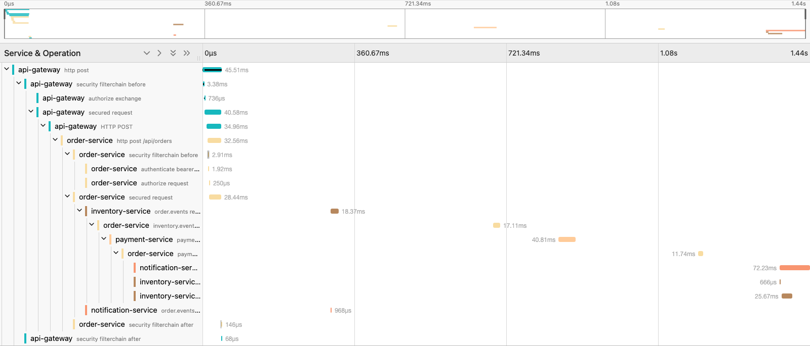
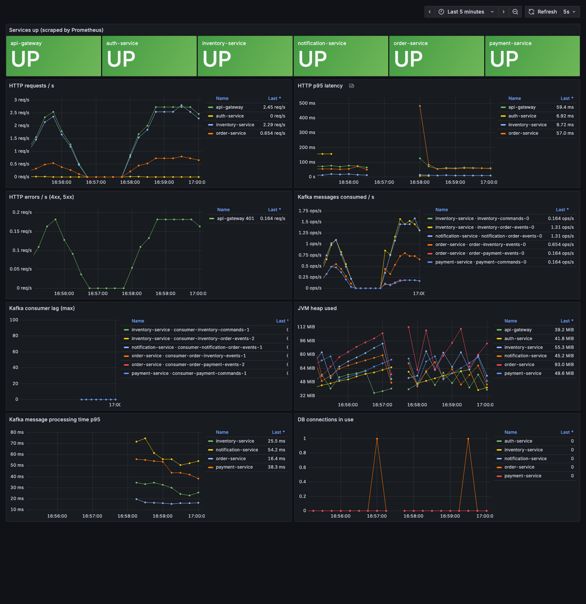

# Микросервисы обработки заказов

Шесть микросервисов Spring Boot обрабатывают заказы интернет-магазина и обмениваются сообщениями через Kafka. Система резервирует товар, имитирует оплату и отправляет уведомление. Если один из шагов завершается ошибкой, оркестратор Saga запускает компенсацию.

В проекте используются Transactional Outbox, идемпотентные потребители, Dead Letter Topics и отдельная база данных для каждого сервиса. Шлюз проверяет JWT и ограничивает частоту запросов. Метрики, трассировка и идентификаторы корреляции позволяют проследить обработку заказа между сервисами.

## Архитектура

```
                 Клиент (JWT)
                     │
             ┌───────▼────────┐  Spring Cloud Gateway: маршрутизация, проверка JWT (JWKS),
             │  API Gateway   │  лимиты через Redis, идентификатор корреляции, CORS
             └──┬───┬───┬───┬─┘
       REST     │   │   │   │
   ┌────────────▼┐ ┌▼───┴───▼──────┐ ┌──────────────┐
   │ auth-service│ │ order-service │ │  inventory   │──┐
   │ RS256 JWT + │ │ Оркестратор   │ │  -service    │  │
   │ JWKS        │ │ Saga          │ └──────▲───────┘  │
   └─────────────┘ └──┬─────▲──────┘        │          │
                      │     │   Топики Kafka (события и команды с ключом orderId)
      ────────────────▼─────┴───────────────┴──────────▼────────────────
                      │     ▲                          │
             ┌────────▼─────┴┐               ┌─────────▼────────────┐
             │payment-service│               │ notification-service │──► почта (MailHog)
             └───────────────┘               └──────────────────────┘

   У каждого сервиса своя база PostgreSQL (auth_db, order_db, inventory_db, payment_db,
   notification_db). Сервисы не обращаются напрямую к чужим таблицам.
```

| Модуль | Порт | Назначение |
|---|---|---|
| `api-gateway` | 8080 | Единая точка входа, маршрутизация, проверка JWT, ограничение частоты запросов через Redis, идентификатор корреляции |
| `auth-service` | 8081 | Регистрация, вход, выдача JWT с подписью RS256 и публикация JWKS |
| `order-service` | 8082 | Заказы, идемпотентное оформление, оркестрация Saga, обработка тайм-аутов и отслеживание возвратов |
| `inventory-service` | 8083 | Каталог, атомарное резервирование остатков, сохранение запросов на освобождение и сверка резервов |
| `payment-service` | 8084 | Симуляция авторизации, отклонения и возврата платежей |
| `notification-service` | 8085 | Письма о подтверждении, отмене и отклонении заказов |
| `common-events` | — | Типы событий и команд, имена топиков и заголовков |
| `service-support` | — | Общая автоконфигурация безопасности, ошибок, корреляции, outbox, идемпотентности, DLT и Swagger |

## Saga заказа

```
POST /api/orders ─► заказ PENDING ─► OrderCreated ─► резервирование остатков
   ├─ StockRejected ─► REJECTED (включая заказ с ранее записанным освобождением)
   └─ StockReserved ─► ProcessPayment ─► симуляция оплаты
         ├─ PaymentCompleted ─► CONFIRMED + CommitStock
         └─ PaymentFailed ─► ReleaseStock ─► CANCELLED

POST /api/orders/{id}/cancel до подтверждения
   └─ ReleaseStock + CANCELLED, возврат при известном payment_id
POST /api/orders/{id}/cancel для CONFIRMED
   └─ RefundPayment + ReleaseStock ─► CANCELLATION_PENDING ─► PaymentRefunded ─► CANCELLED
Поздний PaymentCompleted после отмены или тайм-аута
   └─ RefundPayment + orders.refund_status NONE → REQUESTED в одной транзакции
         └─ PaymentRefunded ─► REFUNDED
Поздний StockReserved для отменённого заказа
   └─ сохранить сведения о резерве и повторить ReleaseStock

Если обработка длится дольше ORDER_SAGA_TIMEOUT, фоновая задача отменяет заказ с компенсацией.
Незавершённые возвраты обрабатывает отдельный проход той же задачи. Если с последней попытки
(orders.refund_retry_at) прошёл ORDER_SAGA_REFUND_RETRY_INTERVAL, задача повторяет RefundPayment.
Заказ при этом не отменяется снова и уведомления о нём не отправляются повторно. Проверка
тайм-аутов пропускает заказы с ожидающим возвратом, поэтому интервалы независимы.
```

`orders.refund_status` (`NONE → REQUESTED → REFUNDED`, миграция `V5__refund_tracking.sql`) отражает состояние возврата независимо от статуса заказа. Платёж, завершившийся одновременно с отменой, подлежит возврату. Команда `RefundPayment` и изменение признака записываются в одной транзакции. Повторное событие не создаёт вторую команду, а `PaymentRefunded` завершает возврат. Поле `orders.refund_retry_at` (миграция `V6__refund_recovery.sql`) хранит время последней попытки, чтобы повторять запрос по установленному интервалу.

| Топик | Сообщения | Отправитель → получатель |
|---|---|---|
| `order.events` | OrderCreated, OrderConfirmed, OrderCancelled, OrderRejected | order → inventory, notification |
| `inventory.events` | StockReserved, StockRejected | inventory → order |
| `inventory.commands` | CommitStock, ReleaseStock | order → inventory |
| `payment.commands` | ProcessPayment, RefundPayment | order → payment |
| `payment.events` | PaymentCompleted, PaymentFailed, PaymentRefunded | payment → order |
| `<topic>.DLT` | Сообщения, которые не удалось обработать | потребитель → оператор |

## Надёжность

- **Transactional Outbox.** Исходящие сообщения записываются в `outbox_events` в той же транзакции, что и изменение состояния. Фоновый обработчик забирает записи через `SELECT … FOR UPDATE SKIP LOCKED`, поэтому могут работать несколько экземпляров сервиса. Публикация использует `acks=all` и идемпотентный продюсер с порядком по заказу. Откат транзакции отменяет и запись события.
- **Идемпотентные потребители.** Идентификатор события записывается в `processed_events` в той же транзакции, что и результат обработки. Повторная доставка Kafka не повторяет операцию.
- **Dead Letter Topics.** Три повторные попытки с экспоненциальной задержкой, затем отправка в `<topic>.DLT`. Неизвестные сообщения и сообщения с неверным форматом отправляются в DLT сразу.
- **Контроль остатков.** Строки склада блокируются в порядке идентификаторов. При конфликте оптимистической блокировки операция повторяется. В тесте с 20 потоками и 10 единицами проходят ровно 10 резервирований.
- **Освобождение резерва до его создания.** `ReleaseStock` сохраняет запись в `order_release_intents` (миграция `V5__order_release_intents.sql`), даже если резерв ещё не создан. `OrderCreated` проверяет её перед резервированием. Транзакционная блокировка PostgreSQL `pg_advisory_xact_lock` упорядочивает операции `OrderCreated`, `ReleaseStock`, `CommitStock` и сверку по одному заказу. Если Saga получает позднее событие о резерве после отмены, она отправляет повторную команду освобождения. Те же правила действуют при прямом вызове `StockReservationService`.
- **Устойчивость к сбоям.** Для запроса цен к inventory-service используются повторные попытки и circuit breaker Resilience4j. При недоступности склада API отвечает `503` с заголовком `Retry-After`.
- **Идемпотентное оформление.** Повтор запроса с тем же `Idempotency-Key` возвращает созданный заказ. Другое тело запроса с тем же ключом даёт `409`. Шлюз разрешает заголовок в настройках CORS.
- **Проверка JWT.** Токен проверяется и на шлюзе, и в каждом сервисе. Шлюз удаляет клиентские заголовки `X-User-Id` и `X-User-Roles`.
- **Корреляция.** `X-Correlation-Id` передаётся из HTTP в заголовки Kafka и выводится в логах сервисов.

## Наблюдаемость

- **Метрики.** Micrometer публикует метрики для Prometheus по адресу `/actuator/prometheus`. Доступны частота HTTP-запросов, p95 задержки, ошибки, объём и время обработки сообщений Kafka, отставание потребителей, использование памяти JVM и соединения с БД.
- **Распределённая трассировка.** Micrometer Tracing и OpenTelemetry экспортируют спаны в Jaeger. Контекст сохраняется в записи outbox и передаётся в заголовке Kafka `traceparent` по стандарту W3C. По одному трейсу можно пройти от шлюза через заказ, склад и оплату до уведомления.
- **Логи.** Формат включает идентификаторы корреляции и трейса, например `[order-service,<correlationId>,<traceId>]`.
- **Grafana.** Дашборд «Order Processing — Overview» открывается как домашняя страница.

Идентификаторы трейсов и передача `traceparent` работают постоянно. `OTLP_TRACING_EXPORT_ENABLED` управляет экспортом завершённых спанов в Jaeger через свойство Spring Boot `management.otlp.tracing.export.enabled`.

| Где запущены сервисы | По умолчанию | Причина |
|---|---|---|
| На хосте | `true`, адрес `localhost:4318` | Профиль `observability` публикует порт Jaeger |
| В Docker (`--profile app`) | `false` | Jaeger запускается в другом профиле. Без коллектора экспорт пишет `ERROR … Failed to export spans` на каждой отправке |

```bash
# Grafana :3000, Prometheus :9090, Jaeger :16686. По умолчанию спаны отправляют сервисы на хосте.
docker compose --profile observability up -d --build

# Сервисы в Docker с профилем observability. Включаем экспорт спанов в Jaeger.
OTLP_TRACING_EXPORT_ENABLED=true docker compose --profile app --profile observability up -d --build
```

Вторая команда запустит Jaeger, Prometheus и Grafana даже без `OTLP_TRACING_EXPORT_ENABLED=true`, но отправка спанов из контейнеров требует этой переменной. Compose пересоздаёт контейнеры сервисов при её изменении. Для постоянной настройки укажи её в `.env`.

**Трассировка одного заказа через пять сервисов**



**Дашборд Grafana под нагрузкой**



## Стек

Java 21 · Spring Boot 3.5 · Spring Cloud Gateway 2025.0 · Spring Kafka (Kafka 4, KRaft) · Spring Data JPA · PostgreSQL 16 · Micrometer · OpenTelemetry · Prometheus · Grafana · Jaeger · Flyway · Redis · Spring Security OAuth2 Resource Server (RS256 / JWKS) · Resilience4j · springdoc-openapi · Testcontainers · Docker Compose · Maven.

## Локальный запуск

Понадобятся JDK 21 и Docker. Для Docker Desktop стенд рассчитан примерно на 4 ГБ памяти.

**Сервисы и инфраструктура в Docker**

```bash
docker compose --profile app up -d --build
```

При таком запуске Jaeger и экспорт спанов отключены. Идентификаторы трейсов остаются в логах. Для экспорта в Jaeger включи профиль из раздела [Наблюдаемость](#наблюдаемость).

**Инфраструктура в Docker, сервисы на хосте**

```bash
docker compose up -d --build --wait                 # Postgres, Kafka, Redis, MailHog
./mvnw -DskipTests install
java -jar auth-service/target/auth-service-0.0.1-SNAPSHOT.jar &
INVENTORY_SEED_DEMO=true java -jar inventory-service/target/inventory-service-0.0.1-SNAPSHOT.jar &
java -jar order-service/target/order-service-0.0.1-SNAPSHOT.jar &
java -jar payment-service/target/payment-service-0.0.1-SNAPSHOT.jar &
java -jar notification-service/target/notification-service-0.0.1-SNAPSHOT.jar &
java -jar api-gateway/target/api-gateway-0.0.1-SNAPSHOT.jar &
```

Скрипт создания баз и пользователей из `infra/postgres/init/` встроен в образ Postgres. После изменения скрипта собери образ с `--build`. Скрипт выполняется при первом запуске с пустым томом.

Сервисы на хосте экспортируют спаны в Jaeger на `localhost:4318`. При запуске без Jaeger задай `OTLP_TRACING_EXPORT_ENABLED=false`, чтобы отключить сообщения об ошибках экспорта.

| Ресурс | Адрес |
|---|---|
| API через шлюз | http://localhost:8080 |
| Swagger UI сервисов | http://localhost:8081..8085/swagger-ui.html |
| Почта (MailHog) | http://localhost:8025 |
| Grafana / Prometheus / Jaeger | http://localhost:3000 · :9090 · :16686 (профиль `observability`) |

Внешние порты инфраструктуры отличаются от стандартных. Postgres использует **5435**, Kafka — **9094**, Redis — **6380**. По умолчанию опубликованные порты привязаны к `127.0.0.1` через `BIND_ADDRESS` в `.env`. Контейнеры обращаются друг к другу по именам сервисов внутри сети Compose. Для доступа извне см. раздел [Перед запуском в сети](#перед-запуском-в-сети).

## Что симулируется

- **Платежи.** Оплата создаёт запись в таблице `payments`, возврат меняет её статус. Идентификаторы имитатора начинаются с `SIM-`. В ответах API есть `"simulated": true`. Платёжные реквизиты и реальные деньги не используются.
- **Почта.** `notification-service` передаёт письма локальному SMTP-приёмнику MailHog. Адрес формируется из идентификатора клиента по шаблону `<customerId>@customers.orders.local`. В ответе API есть `"simulated": true`. Статус `SENT` означает, что письмо принял SMTP-приёмник.

Демонстрационный каталог состоит из вымышленных товаров `DEMO-*` в локальной базе.

## Сценарии заказов

Docker Compose по умолчанию загружает демонстрационные товары через `INVENTORY_SEED_DEMO=true`. Для примеров нужны `curl` и `jq`.

```bash
# Регистрируем пользователя и сохраняем токен.
TOKEN=$(curl -s localhost:8080/api/auth/register -H 'Content-Type: application/json' \
  -d '{"name":"Ada","email":"ada@example.com","password":"Password123"}' | jq -r .accessToken)

# В каталоге по умолчанию семь демонстрационных товаров.
PRODUCTS=$(curl -fsS localhost:8080/api/products)
printf '%s\n' "$PRODUCTS" | jq '.content[] | {id, sku, price, availableQuantity}'
HEADSET_ID=$(printf '%s\n' "$PRODUCTS" | jq -er '.content[] | select(.sku == "DEMO-HEADSET-PRO") | .id')
SPEAKER_ID=$(printf '%s\n' "$PRODUCTS" | jq -er '.content[] | select(.sku == "DEMO-LIMITED-SPEAKER") | .id')
MONITOR_ID=$(printf '%s\n' "$PRODUCTS" | jq -er '.content[] | select(.sku == "DEMO-PREMIUM-MONITOR") | .id')
KEYBOARD_ID=$(printf '%s\n' "$PRODUCTS" | jq -er '.content[] | select(.sku == "DEMO-KEYBOARD-87") | .id')

# Шаги Saga асинхронны. Ждём, пока заказ перейдёт в нужное состояние.
wait_for_order() {
  order_id=$1 expected=$2
  for attempt in $(seq 1 30); do
    status=$(curl -fsS "localhost:8080/api/orders/$order_id" \
      -H "Authorization: Bearer $TOKEN" | jq -r .status) || return 1
    if [ "$status" = "$expected" ]; then printf '%s\n' "$status"; return 0; fi
    sleep 1
  done
  printf 'Order %s did not reach %s (last status: %s)\n' "$order_id" "$expected" "$status" >&2
  return 1
}
```

**1. Успешный заказ.** Цена `DEMO-HEADSET-PRO` — 199.99, ниже порога отклонения 1000.00.

```bash
ORDER_OK=$(curl -s localhost:8080/api/orders -H "Authorization: Bearer $TOKEN" \
  -H 'Content-Type: application/json' -H 'Idempotency-Key: checkout-1' \
  -d "{\"items\":[{\"productId\":\"$HEADSET_ID\",\"quantity\":1}]}" | jq -r .id)

wait_for_order "$ORDER_OK" CONFIRMED
# CONFIRMED
curl -s localhost:8080/api/payments/order/$ORDER_OK -H "Authorization: Bearer $TOKEN" | jq '{status, simulated}'
# { "status": "AUTHORIZED", "simulated": true }
```

**2. Недостаточно остатков.** У `DEMO-LIMITED-SPEAKER` две единицы в наличии. Попробуй заказать три.

```bash
ORDER_NOSTOCK=$(curl -s localhost:8080/api/orders -H "Authorization: Bearer $TOKEN" \
  -H 'Content-Type: application/json' -H 'Idempotency-Key: checkout-2' \
  -d "{\"items\":[{\"productId\":\"$SPEAKER_ID\",\"quantity\":3}]}" | jq -r .id)

wait_for_order "$ORDER_NOSTOCK" REJECTED
# REJECTED — товар не зарезервирован.
```

**3. Отклонение оплаты.** Цена `DEMO-PREMIUM-MONITOR` — 1499.00, выше порога.

```bash
ORDER_DECLINED=$(curl -s localhost:8080/api/orders -H "Authorization: Bearer $TOKEN" \
  -H 'Content-Type: application/json' -H 'Idempotency-Key: checkout-3' \
  -d "{\"items\":[{\"productId\":\"$MONITOR_ID\",\"quantity\":1}]}" | jq -r .id)

wait_for_order "$ORDER_DECLINED" CANCELLED
# CANCELLED — имитатор отклонил платёж, и Saga освободила резерв.
curl -s localhost:8080/api/payments/order/$ORDER_DECLINED -H "Authorization: Bearer $TOKEN" | jq .status
# FAILED
```

**4. Отмена.** Создай заказ на клавиатуру и запроси отмену. Если Saga успеет подтвердить заказ, отмена также запустит симуляцию возврата.

```bash
ORDER_CANCEL=$(curl -s localhost:8080/api/orders -H "Authorization: Bearer $TOKEN" \
  -H 'Content-Type: application/json' -H 'Idempotency-Key: checkout-4' \
  -d "{\"items\":[{\"productId\":\"$KEYBOARD_ID\",\"quantity\":1}]}" | jq -r .id)

curl -s -X POST localhost:8080/api/orders/$ORDER_CANCEL/cancel -H "Authorization: Bearer $TOKEN"
wait_for_order "$ORDER_CANCEL" CANCELLED
```

**5. Возврат.** Отмени подтверждённый заказ `$ORDER_OK` из первого шага. Saga запросит возврат и освободит резерв.

```bash
curl -s -X POST localhost:8080/api/orders/$ORDER_OK/cancel -H "Authorization: Bearer $TOKEN"

wait_for_order "$ORDER_OK" CANCELLED
# CANCELLED
curl -s localhost:8080/api/payments/order/$ORDER_OK -H "Authorization: Bearer $TOKEN" | jq '{status, simulated}'
# { "status": "REFUNDED", "simulated": true }
```

У каждого сценария свой идентификатор заказа. Повторный запуск шага использует тот же `Idempotency-Key` и возвращает существующий заказ.

Уведомления, которые принял MailHog:

```bash
curl -s localhost:8080/api/notifications/me -H "Authorization: Bearer $TOKEN" | jq '.content[] | {type, recipient, status, simulated}'
```

Демонстрационный администратор (`admin@orders.local` / `Admin@LocalDevOnly`) управляет товарами по `/api/inventory/**`. Параметры `AUTH_ADMIN_*` используются при создании учётной записи. Чтобы задать пароль для новой базы, укажи `AUTH_ADMIN_PASSWORD` до первого запуска.

## API через шлюз

| Метод и путь | Доступ |
|---|---|
| `POST /api/auth/register`, `POST /api/auth/login` | Открытый |
| `GET /api/auth/me` | Пользователь |
| `GET /api/products`, `GET /api/products/{id}` | Открытый |
| `POST/PUT/PATCH/DELETE /api/inventory/products/**` | Администратор |
| `POST /api/inventory/reservations/reconcile` | Администратор. Статус каждого заказа проверяется в order-service |
| `GET /api/inventory/reservations?orderId=` | Администратор |
| `POST /api/orders` (необязательный `Idempotency-Key`) | Пользователь |
| `GET /api/orders/me`, `GET /api/orders/{id}`, `POST /api/orders/{id}/cancel` | Владелец или администратор |
| `GET /api/orders/{id}/events` (топик, время и идентификатор трейса для событий и команд заказа) | Владелец или администратор |
| `GET /api/orders` | Администратор |
| `GET /api/payments/order/{orderId}` | Владелец или администратор |
| `GET /api/notifications/me` | Пользователь |

## Конфигурация

В [`.env.example`](.env.example) перечислены параметры и локальные значения по умолчанию. Основные переменные:

| Параметр | Назначение |
|---|---|
| `AUTH_JWT_PRIVATE_KEY`, `AUTH_JWT_PUBLIC_KEY` | Постоянная пара ключей. Если оба поля пустые, сервис генерирует пару при запуске |
| `PAYMENT_DECLINE_ABOVE` | Порог отклонения платежа, по умолчанию 1000.00 |
| `ORDER_SAGA_TIMEOUT` | Тайм-аут обработки заказа, по умолчанию 2 минуты |
| `ORDER_SAGA_REFUND_RETRY_INTERVAL` | Интервал повторного запроса возврата, по умолчанию 30 секунд |
| `RATE_LIMIT_REPLENISH_RATE`, `RATE_LIMIT_BURST_CAPACITY` | Скорость пополнения и ёмкость лимита запросов |
| `INVENTORY_SEED_DEMO` | Загрузка демонстрационного каталога |
| `NOTIFICATION_RECIPIENT_DOMAIN` | Домен демонстрационных почтовых адресов |

**Обновление схемы.** Flyway применяет изменения при запуске. Миграции заказа `V5__refund_tracking.sql`, `V6__refund_recovery.sql` и складская `V5__order_release_intents.sql` добавляют поля, ограничение, индексы и таблицу. Существующие заказы получают статус возврата `NONE`. Для уже запрошенных возвратов `refund_retry_at` заполняется значением `updated_at`.

### Восстановление зависших резервов

На стендах до `V5__order_release_intents.sql` у отменённого заказа мог остаться резерв, если команда освобождения обработалась раньше самого резервирования.

```sql
-- 1) Необязательно: найти идентификаторы кандидатов в базе order-service.
--    Результат запроса сам по себе не разрешает освобождение.
SELECT id, status, updated_at FROM orders WHERE status IN ('CANCELLED', 'REJECTED') ORDER BY updated_at DESC;
-- Проблемные резервы всё ещё находятся в статусе RESERVED в inventory_db.stock_reservations.
```

```bash
# 2) Передать inventory-service явный список из не более чем 200 идентификаторов без null.
#    Ответ содержит по одному результату для каждого уникального заказа.
curl -X POST http://localhost:8080/api/inventory/reservations/reconcile \
  -H "Authorization: Bearer $ADMIN_TOKEN" -H 'Content-Type: application/json' \
  -d '{"orderIds":["<id1>","<id2>"],"reason":"incident 1234 cleanup"}'
# Статус заказа подтверждён (CANCELLED/REJECTED): RELEASED | ALREADY_RELEASED | NO_RESERVATIONS | SKIPPED_COMMITTED
# Без изменений: REFUSED_ACTIVE_ORDER | REFUSED_ORDER_NOT_FOUND | REFUSED_ACCESS_DENIED |
#                           REFUSED_UNVERIFIABLE | REFUSED_VERIFICATION_UNAVAILABLE |
#                           SKIPPED_VERIFICATION_UNAVAILABLE
```

Для каждого идентификатора inventory-service вызывает `GET /api/orders/{id}` по `ORDER_BASE_URL` (`http://localhost:8082` на хосте, `http://order-service:8082` в Compose). Клиент передаёт исходный токен администратора без записи в логи. Освобождение допускается только после корректного ответа `200` с тем же идентификатором и статусом `CANCELLED` или `REJECTED`.

Другие статусы, ошибки доступа, `404`, тайм-ауты, `5xx`, редиректы, некорректное или слишком большое тело ответа, а также ответ по другому заказу оставляют остатки, резервы, outbox и записи об освобождении без изменений. Тайм-ауты подключения и чтения составляют 1 и 2 секунды (`ORDER_CONNECT_TIMEOUT_MS` и `ORDER_READ_TIMEOUT_MS`). После трёх последовательных сбоев оставшиеся идентификаторы получают `SKIPPED_VERIFICATION_UNAVAILABLE`. После восстановления зависимости запрос можно повторить.

Сверка освобождает строки `RESERVED` и сохраняет признак освобождения, чтобы повторный `OrderCreated` не создал резерв снова. Заказы со строками `COMMITTED` обрабатываются через обычный возврат платежа и `ReleaseStock` после `PaymentRefunded`. Сетевой вызов выполняется до складской транзакции. Транзакционная advisory-блокировка упорядочивает сверку и обычные операции по заказу.

## Перед запуском в сети

Значения с суффиксом `*_local_dev_only` предназначены для локального стенда.

1. Порты по умолчанию привязаны к `127.0.0.1`. Для доступа извне явно задай `BIND_ADDRESS`, например `BIND_ADDRESS=0.0.0.0`. Оставь базы, Kafka, Redis и MailHog в закрытой сети.
2. Замени пароли в `.env`, включая `POSTGRES_SUPERUSER_PASSWORD`, пять `*_DB_PASSWORD`, `REDIS_PASSWORD`, `GRAFANA_ADMIN_PASSWORD` и `AUTH_ADMIN_PASSWORD`. Скрипт `infra/postgres/init/01-create-databases.sh` создаёт пользователей при первом запуске на пустом томе. Для существующей базы поменяй пароли через `ALTER ROLE`. Пересоздание тома удалит сохранённые данные.
3. Задай `AUTH_JWT_PRIVATE_KEY` и `AUTH_JWT_PUBLIC_KEY`. Без них сервис генерирует 2048-битную пару при каждом запуске, и ранее выданные токены перестают работать.
4. Укажи адрес брокера для клиентов через `KAFKA_EXTERNAL_HOST`. Включай `OTLP_TRACING_EXPORT_ENABLED=true` вместе с профилем `observability`.
5. Postgres проверяет пароль пользователя через `scram-sha-256`. Kafka в этом стенде запускается без SASL/TLS. Redis требует пароль только при заданном `REDIS_PASSWORD`. MailHog принимает сообщения без аутентификации.

## Тесты

Интеграционные тесты используют PostgreSQL и Kafka через Testcontainers, поэтому для них нужен Docker. Тесты проверяют переходы и компенсации Saga, атомарность outbox и повторные попытки публикации, идемпотентность, DLT, конкурентные операции склада, безопасность шлюза, ограничение частоты запросов, CORS и circuit breaker.

- `OrderSagaLatePaymentTest` проверяет единственный возврат после позднего `PaymentCompleted`, обработку дубликатов, повтор потерянной команды и гонку между отменой и оплатой.
- `InventorySagaReleaseIntentTest`, `OrderSagaLateInventoryTest` и `InventoryReservationReconciliationTest` проверяют освобождение до резервирования, повторные команды, поздний `StockReserved` и отказ от ручной сверки подтверждённых продаж.
- `StockReservationPrimitiveGuardsTest` воспроизводит конкурентные вызовы складского сервиса на PostgreSQL. `ReservationReconciliationVerificationTest` и `OrderStatusClientTest` проверяют отказы при активном, неизвестном или недоступном заказе, тайм-ауте и некорректном ответе.

```bash
./mvnw verify
```

## Ограничения

- Платёжный сервис использует детерминированный имитатор. Он отклоняет суммы выше `PAYMENT_DECLINE_ABOVE` и может отклонять заданную долю заказов. Реальная интеграция потребовала бы вебхуков провайдера, хранения ключей и учёта требований PCI.
- Письма отправляются на синтетический адрес `<customerId>@NOTIFICATION_RECIPIENT_DOMAIN` (`customers.orders.local` по умолчанию). Для отправки клиентам потребовался бы источник проверенных адресов.
- SMTP-доставка допускает повторную отправку. Если процесс упадёт после отправки письма, но до фиксации записи об обработке, Kafka доставит событие снова. Ошибка SMTP откатывает обработку события и запускает повторные попытки.
- Без заданной пары ключей RSA токены перестают действовать после перезапуска auth-service.
